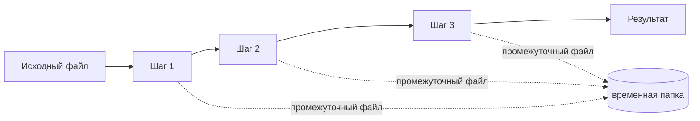
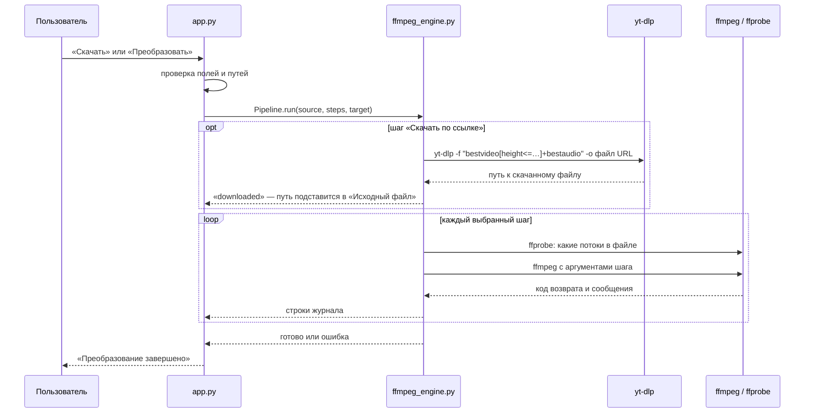

# FFprog


**FFprog — простая графическая программа для обработки видео и звука.**
Она не умеет сама кодировать файлы: вся тяжёлая работа достаётся программе
**FFmpeg**, а FFprog даёт к ней понятный «пульт» с кнопками и полями.

Выберите файл (или скачайте его по ссылке с YouTube, VK Video и ещё ~1800
сайтов), добавьте нужные действия в цепочку (обрезать, конвертировать, склеить,
изменить громкость, изменить скорость) — программа выполнит их по очереди и
покажет, какие именно команды запускала.

```
файл или ссылка  →  [ действие 1 ] → [ действие 2 ] → … →  новый файл
```

---

## Содержание

1. [Что нужно для работы](#что-нужно-для-работы). 
2. [Словарик](#словарик)
3. [Установка и запуск](#установка-и-запуск)
4. [Первый запуск за 6 шагов](#первый-запуск-за-6-шагов)
5. [Скачивание по ссылке](#скачивание-по-ссылке)
6. [Инструменты цепочки](#инструменты-цепочки)
7. [Как собирается цепочка действий](#как-собирается-цепочка-действий)
8. [Форматы, кодеки и качество](#форматы-кодеки-и-качество)
9. [Правила для времени, громкости и скорости](#правила-для-времени-громкости-и-скорости)
10. [Имя и место результата](#имя-и-место-результата
11. [Журнал, отмена и прогресс](#журнал-отмена-и-прогресс)
12. [Как это работает внутри](#как-это-работает-внутри)
13. [Структура проекта](#структура-проекта)
14. [Тесты](#тесты)
15. [Частые ошибки и что делать](#частые-ошибки-и-что-делать)
16. [Ограничения](#ограничения)
17. [Планируемые улучшения](#планируемые-улучшения)

---

## Словарик

| Слово | Простое объяснение |
|---|---|
| **FFmpeg** | программа-«швейцарский нож» для видео и звука; умеет почти всё, но управляется командами |
| **FFprobe** | помощник FFmpeg, который только читает файл и рассказывает, что внутри |
| **Контейнер** | «коробка» с расширением `.mp4`, `.mkv`, `.mp3`; внутри лежат дорожки |
| **Кодек** | способ сжатия дорожки: H.264, VP9, AAC, MP3 и другие |
| **Перекодирование** | распаковать и заново сжать; качество может немного измениться, зато формат становится нужным |
| **Битрейт** | сколько данных тратится на секунду звука или видео; больше — лучше качество и больше файл |
| **CRF** | «сила сжатия» видео у H.264/VP9; меньше число — лучше качество |
| **Пресет** | настройка скорости кодирования; `veryfast` — быстро, с небольшим проигрышем в размере |
| **Поток / дорожка** | отдельная часть файла: видеодорожка, аудиодорожка, субтитры |
| **Ссылка (URL)** | адрес в интернете (`https://…`); в проекте скачивание — единственное место, где она нужна |
| **Путь** | адрес локального файла (`/home/u/Видео/2.mp4`); выбирается через диалог «Открыть» |
| **Temp-папка** | временное место для промежуточных файлов; удаляется после работы |

### Термины: «ссылка» и «путь»

Чтобы не путаться, в проекте слова разделены строго:

| Термин | Что означает | Где используется |
|---|---|---|
| **ссылка (URL)** | адрес в интернете: `https://…` | только «Скачать по ссылке» |
| **путь** | локальный файл: `/home/u/Видео/2.mp4` | выбор файла через диалог «Открыть», список приклеиваемых файлов в «Склеить» |

В «Склеить» добавляются именно **пути** к локальным файлам, а не ссылки.

---

## Что нужно для работы

| Компонент | Зачем нужен | Как проверить |
|---|---|---|
| **Python 3** (желательно 3.8+) | на нём написана программа | `python3 --version` |
| **Tkinter** | рисует окно с кнопками | `python3 -m tkinter` |
| **FFmpeg** | выполняет всю обработку видео и звука | `ffmpeg -version` |
| **FFprobe** | определяет, что внутри файла (видео, звук, длительность) | `ffprobe -version` |
| **yt-dlp** (необязательно) | нужен только для «Скачать по ссылке» | `yt-dlp --version` |

`ffmpeg` и `ffprobe` обычно ставятся вместе, одним пакетом. Без `yt-dlp`
программа работает как раньше — недоступна только загрузка по ссылке.

### Установка зависимостей

**Debian / Ubuntu / Linux Mint:**

```bash
sudo apt update
sudo apt install python3 python3-tk ffmpeg yt-dlp
```

**Fedora:**

```bash
sudo dnf install python3 python3-tkinter ffmpeg yt-dlp
```

**Arch Linux / Manjaro:**

```bash
sudo pacman -S python tk ffmpeg yt-dlp
```

> Если `ffmpeg` не находится, FFprog при запуске покажет окно с ошибкой и не
> откроется. Это сделано специально, чтобы программа не «падала» посреди работы.
>
> Если `yt-dlp` не установлен, кнопка «Скачать» всё равно активна, но при
> нажатии появится подсказка, как его поставить. Сайты (YouTube, VK) без него
> скачать нельзя — для прямой ссылки на файл сработает встроенный загрузчик.

---

## Установка и запуск

Есть три способа запуска. Для первого знакомства достаточно любого из первых двух.

### Способ 1. Прямо из папки проекта (самый простой)

```bash
cd /путь/к/FFprog
./run.sh
```

`run.sh` сам проверит наличие Python, `ffmpeg` и `ffprobe`, а затем запустит
`app.py`. Можно также запустить напрямую:

```bash
python3 app.py
```

### Способ 2. Ярлык в меню приложений

```bash
./install_shortcut.sh
```

Скрипт создаст файл
`~/.local/share/applications/ffprog.desktop` с абсолютным путём к `run.sh`,
иконкой `ffprog.svg` и категорией «Аудио и видео». После этого FFprog
появится в меню приложений и будет запускаться одним кликом.

Удалить ярлык вручную:

```bash
rm ~/.local/share/applications/ffprog.desktop
```

### Способ 3. Готовый deb-пакет

Соберите пакет из корня проекта:

```bash
python3 build_deb.py
```

В папке `deb/` появится `ffprog_1.2.0-1_all.deb`. Он устанавливает:

| Что | Куда |
|---|---|
| команда запуска `ffprog` | `/usr/bin/ffprog` |
| код программы | `/usr/lib/ffprog/` |
| ярлык меню | `/usr/share/applications/ffprog.desktop` |
| иконка | `/usr/share/icons/hicolor/scalable/apps/ffprog.svg` |
| README и copyright | `/usr/share/doc/ffprog/` |

Launcher `/usr/bin/ffprog` проверяет наличие Python, Tkinter, ffmpeg и
`DISPLAY` — при отсутствии чего-либо выводит понятную подсказку вместо
Traceback. Поддерживает `--check` для проверки окружения без окна.

Установка:

```bash
sudo apt install ./deb/ffprog_1.2.0-1_all.deb
```

или

```bash
sudo dpkg -i deb/ffprog_1.2.0-1_all.deb
```

После установки программу можно запустить из меню или командой:

```bash
ffprog
```

Удаление:

```bash
sudo apt remove ffprog
```

При удалении ярлык меню автоматически убирается.

Пакет сам зависит от `python3`, `python3-tk` и `ffmpeg`, поэтому `apt`
подскажет, чего не хватает.

---

## Перенос проекта в другую папку или на другой компьютер

Проект не содержит абсолютных путей — `run.sh`, `app.py` и `install_shortcut.sh`
сами определяют, в какой папке лежат. Копируйте **всю папку целиком**:

```bash
cp -r /старый/путь/FFprog /новый/путь/FFprog
cd /новый/путь/FFprog
./install_shortcut.sh     # обновит ярлык меню под новое расположение
./run.sh
```

Если после копирования что-то не запускается, пройдите по чек-листу.

> **Скрипты лечат себя сами.** `run.sh` при запуске замечает windows-переносы
> строк (`CRLF`) и чистит их, а `install_shortcut.sh` заодно починит все `.sh`
> в папке и вернёт им бит исполнения. Достаточно один раз выполнить
> `bash install_shortcut.sh` — даже если сами скрипты пришли с Windows и без
> `+x`. Единственный случай, когда `run.sh` не справляется в одиночку: запуск
> вида `./run.sh` на файле с CRLF, где ядро не может прочитать shebang
> `bash\r`. Тогда нужен `bash run.sh` или `bash install_shortcut.sh`.

| Симптом | Причина | Что сделать |
|---|---|---|
| `Отказано в доступе` при `./run.sh` | при переносе через zip / флешку / NTFS теряется бит исполнения | `chmod +x run.sh install_shortcut.sh` **или** запустить `bash run.sh` |
| `env: 'bash\r': Нет такого файла` | после переноса через Windows в скриптах остались CRLF-переносы (`\r\n`) | `bash install_shortcut.sh` (починит все `.sh`) **или** вручную `sed -i 's/\r$//' *.sh` |
| `Bad substitution` | скрипт запустили через `sh`, а в системе `/bin/sh` — это `dash` | обновите скрипты; текущая версия совместима с POSIX sh и сама перезапускается под `bash` |
| `рядом с run.sh не найден app.py` | скопировали только скрипты, без кода | скопируйте папку проекта целиком |
| `ModuleNotFoundError: No module named 'tkinter'` | на новом хосте не установлен Tkinter | `sudo apt install python3-tk` (Fedora: `python3-tkinter`, Arch: `tk`) |
| `DISPLAY не задан` | запуск по ssh или в сервисе без графики | запустите из графической сессии либо задайте `DISPLAY=:1 ./run.sh` |
| Ярлык меню стартует «в никуда» | указывает на старый путь | выполните `./install_shortcut.sh` из нового места |
| Не работает кнопка «Открыть папку» | нет `xdg-open` / файлового менеджера | установите `xdg-utils` и любой ФМ (`pcmanfm`, `thunar`, `nautilus`) |

Проверить окружение на новом хосте, не открывая окно:

```bash
./run.sh --check
# OK: каталог /новый/путь/FFprog, python=Python 3.13.5, ffmpeg=7.1.5
```

`--check` (он же `--no-gui`) проверяет наличие `app.py`, Python, Tkinter,
`ffmpeg`/`ffprobe` и пишет, чем именно доустановить недостающее.

> **Docker-вариант.** Если на целевой машине ставить Python и FFmpeg не хочется,
> соберите образ (`python3 build_image.py`) и запускайте `./run-ffprog.sh` —
> ему нужны только Docker и X-сессия. Подробности — в `docker/instruct.md`.

---

## Первый запуск за 6 шагов

1. **Выберите исходный файл.** Нажмите «Поиск…» и укажите видео или музыку.
   Под полем появится информация: например, `видео + аудио, длительность
   00:02:35`. Это значит, что внутри есть и картинка, и звук.
2. **Выберите действие в первом выпадающем списке.** По умолчанию уже выбрана
   «Обрезка». Список содержит все пять инструментов; если нужно больше шагов,
   нажмите «+» под строкой.
3. **Заполните параметры** под списком. Для обрезки это начало и конец
   фрагмента, для конвертации — формат, и так далее. У каждого инструмента
   есть ещё два общих списка: «Качество видео» и «Качество звука».
4. **Проверьте поле «Результат».** Имя подставляется автоматически:
   `исходное_имя_out.mp4`. Можно нажать «Сохранить как…» и выбрать другое место.
5. **Нажмите «Преобразовать».** Кнопка активна, когда выбран файл и хотя бы
   один инструмент.
6. **Дождитесь надписи «Преобразование завершено»** в журнале. Рядом с итоговым
   файлом можно открыть папку кнопкой «Открыть папку».

Во время работы кнопка «Преобразовать» блокируется, зато становится доступна
«Отмена».

---

## Скачивание по ссылке

Над инструментами находится панель «Скачать по ссылке (YouTube, VK Video и др.)».

1. Вставьте URL в поле «Ссылка».
2. Нажмите «Показать варианты» — yt-dlp запросит у сайта доступные форматы.
   Список заполнится вариантами с указанием разрешения, контейнера и битрейта.
3. Выберите нужный вариант из списка.
4. Нажмите «Скачать». После завершения путь автоматически подставится в поле
   «Исходный файл» — файл готов к обработке обычными инструментами.

> Формат и качество звука на этом шаге не выбираются: скачивается ровно тот
> вариант, который отдаёт сайт, без какого-либо перекодирования. Если нужен
> другой формат (например, mp3) или другое качество — добавьте после скачивания
> шаг «Конвертация» и укажите его там.

> Для скачивания с YouTube, VK и других сайтов нужен установленный `yt-dlp`.
> Для прямой ссылки на файл (например, `.mp4` на хостинге) загрузка сработает
> и без `yt-dlp` — через встроенный `urllib`.

---

## Инструменты цепочки

У каждого инструмента есть своё поле параметров. В одной цепочке инструменты
можно **повторять** — например, сначала обрезать, потом ещё раз обрезать.

По умолчанию в окне видна **одна** строка «Инструмент 1». Кнопка **«+»** под
строками добавляет следующую, а у каждой добавленной строки появляется кнопка
**«−»**, убирающая именно её. Нумерация пересчитывается автоматически, верхний
предел — 10 строк. Первая строка остаётся всегда: без неё не от чего
оттолкнуться, а пустая цепочка всё равно не запускается.

Строки, в которых выбран вариант «— не выбран —», в цепочку не попадают,
поэтому лишние строки можно просто оставить пустыми.

### Качество есть у всех пяти инструментов

Под параметрами каждого инструмента расположены два выпадающих списка:

| Список | Варианты | По умолчанию |
|---|---|---|
| Качество видео | Максимальное, Высокое, Среднее, Низкое | Высокое |
| Качество звука | Максимальное, Высокое, Среднее, Низкое, Сверх Низкое | Среднее |

Правила такие:

- **список активен только если соответствующая дорожка есть в файле.** Для
  аудиофайла (mp3, flac, wav…) список «Качество видео» неактивен — остаётся
  только выбор качества звука. Для видео без звуковой дорожки, наоборот,
  недоступен список качества звука;
- **качество каждой строки независимо.** Цепочка может обрезать файл в
  «Низком» качестве (быстро), а финальную конвертацию сделать в «Максимальном»;
- **у «Громкости» у видео есть дополнительный вариант «Без изменений»** — он
  стоит по умолчанию. Тогда картинка копируется как есть (`-c:v copy`), без
  потери качества и без лишнего ожидания. Остальные четыре инструмента видео
  всегда перекодируют, поэтому вариант «Без изменений» им не предлагается;
- **в «Конвертации» список качества видео гасится, если выбран аудиоформат** —
  в mp3 или wav видеодорожка не сохраняется, и выбирать для неё качество бессмысленно.

### 1. Обрезка

Оставляет только кусок от «Начала» до «Конца». Всё, что было раньше начала и
позже конца, выбрасывается.

| Поле | Что означает | Пример |
|---|---|---|
| Начало | время, с которого начинается фрагмент | `00:00:05` |
| Конец | время, на котором фрагмент заканчивается | `00:01:15` |
| Качество видео | насколько бережно перекодировать картинку | `Высокое` |
| Качество звука | битрейт звуковой дорожки | `Среднее` |

Что происходит внутри: FFmpeg получает `-ss` (начало) и `-t` (длительность,
то есть «конец минус начало»). Программа **перекодирует** фрагмент, а не просто
копирует байты. Это чуть медленнее, но кадры и звук не «плывут» на границах,
а кодек автоматически подбирается под контейнер результата (mp4/mkv/mov —
H.264 + AAC, webm — VP9 + Opus, avi — MPEG-4 + MP3).

> Хотите извлечь только звук? Сначала выполните «Конвертацию» в mp3: она уберёт
> видеодорожку. А уже потом обрезайте получившийся аудиофайл.

### 2. Конвертация

Меняет формат (контейнер) и качество.

| Поле | Что означает |
|---|---|
| Конечный формат | в какой файл превратить результат |
| Качество видео | насколько сильно сжимать картинку; чем выше, тем больше файл |
| Качество звука | насколько сильно сжимать звук; чем выше, тем больше файл |

Видеоформаты: `mp4`, `mkv`, `mov`, `avi`, `webm`.
Аудиоформаты: `mp3`, `aac`, `m4a`, `flac`, `ogg`, `opus`, `wav`.
Первым в списке стоит вариант **«— только звук —»**.
По умолчанию выбран `mp4`, качество видео «Высокое», качество звука «Среднее».

Особенности:

- **«— только звук —» вырезает видеодорожку, но контейнер не меняет**: звук
  остаётся в том же контейнере, что и у исходника (`mp4` → `mp4` без картинки).
  Расширение результата при этом остаётся прежним, а кодек звука подбирается
  по нему. Список качества видео в этом режиме неактивен;
- видеоформат нельзя получить из файла без видеодорожки (например, из mp3) —
  программа сразу сообщит об ошибке и не начнёт кодирование;
- аудиоформат нельзя получить из файла без звука — будет такое же сообщение;
- при конвертации в аудиоформат видеодорожка отбрасывается, а список качества
  видео становится неактивным;
- при конвертации в видеоформат звук сохраняется, если он есть;
- у видео качество — это CRF, у звука — битрейт (см. раздел
  «Форматы, кодеки и качество»).

### 3. Склеивание

Соединяет текущий файл с дополнительными файлами в один, по порядку:
**сначала исходный, затем добавленные сверху вниз**.

Как пользоваться:

1. Выберите «Склеивание» в строке.
2. Нажмите «+», чтобы добавить кнопку выбора файла.
3. Нажмите на появившуюся кнопку и выберите файл (на ней будет его имя).
4. Повторите «+» и выбор для остальных файлов.
5. Лишний файл убирается кнопкой «×».

Под кнопками показывается итоговый порядок, например:
`порядок: исходный файл, затем a.mp4 → b.mp4`.

Что происходит внутри:

1. Сначала пробуется **быстрая склейка** без перекодирования
   (`-f concat -c copy`). Она работает, только если файлы совпадают по
   контейнеру и кодекам. Качество в этом случае не меняется вообще — байты
   просто склеиваются.
2. Если быстрый способ не сработал, программа автоматически переходит к
   **склейке через фильтр `concat`** с перекодированием — вот тогда
   используются выбранные вами качество видео и качество звука. Это медленнее,
   но надёжнее и умеет объединять файлы из разных контейнеров.
3. Все файлы должны иметь **одинаковый набор потоков**: либо во всех есть и
   видео, и звук, либо во всех только видео, либо во всех только звук.
   Смешивать «видео+аудио» с «только аудио» нельзя — появится понятная ошибка.

Склеивание можно ставить в середину цепочки: оно соединит результат предыдущих
шагов с дополнительными файлами, а следующие шаги обработают уже общий файл.

### 4. Громкость

Умножает громкость звука на число.

| Значение | Результат |
|---|---|
| `1.0` или `100%` | без изменений |
| `0.5` или `50%` | тише в два раза |
| `1.5` или `150%` | в полтора раза громче |
| `2.0` или `200%` | громче в два раза |

Можно вводить число вручную или нажать готовую кнопку. Дробная часть
принимается и с точкой, и с запятой (`1,5`). Отрицательная громкость
запрещена.

По умолчанию видеодорожка **не перекодируется** (в списке стоит «Без
изменений» → `-c:v copy`) — меняется только звук, поэтому шаг выполняется
быстро и картинка не теряет качество. Если картинку всё же нужно пержать
(например, чтобы уменьшить размер файла), выберите там нужное качество.
Звук всегда перекодируется с выбранным битрейтом. Если звука в файле нет,
программа сообщит, что менять нечего.

### 5. Скорость

Ускоряет или замедляет и видео, и звук одновременно.

| Значение | Результат |
|---|---|
| `0.5` | вдвое медленнее |
| `1.0` | без изменений |
| `1.25` | на 25% быстрее |
| `2.0` | вдвое быстрее |

Внутри используются два фильтра: `setpts=PTS/коэффициент` для картинки и
`atempo` для звука. Фильтр `atempo` умеет менять скорость только в пределах
от 0.5 до 2.0, поэтому большие значения программа автоматически разбивает на
цепочку фильтров (например, для скорости 4.0 — `atempo=2.0,atempo=2.0`).
Звук при этом не превращается в «бурундука»: темп меняется с сохранением
высоты тона.

Скорость должна быть больше нуля.

---

## Как собирается цепочка действий

В окне одна строка «Инструмент 1», а кнопка «+» добавляет столько следующих,
сколько нужно (до 10). Каждая строка — один шаг. Пустая строка
(«— не выбран —») просто пропускается. Шаги выполняются **сверху вниз**.



Правила:

- хотя бы один инструмент должен быть выбран, иначе кнопка «Преобразовать»
  не сработает;
- каждый шаг получает результат предыдущего;
- между шагами создаются временные файлы `.mkv` (если есть видео) или `.mka`
  (если только звук);
- временная папка удаляется автоматически после успеха, ошибки или отмены;
- в строке «Склеивание» должен быть хотя бы один дополнительный файл;
- если файл получен кнопкой «Скачать», он автоматически попадает в поле
  «Исходный файл» и дальше обрабатывается как обычный — отдельно запускать
  скачивание и конвертацию не нужно.

Пример полезной цепочки:

| Строка | Инструмент | Параметры | Что делает |
|---|---|---|---|
| 1 | Конвертация | mp4, видео «Высокое» | приводит файл к mp4 |
| 2 | Обрезка | `00:00:10` – `00:00:40` | оставляет 30 секунд |
| 3 | Громкость | `1.5` | делает звук громче |
| 4 | Скорость | `1.25` | немного ускоряет |

---

## Форматы, кодеки и качество

### Видео

| Формат | Видеокодек | Как задаётся качество | Звук в контейнере |
|---|---|---|---|
| `mp4` | H.264 (`libx264`) | CRF, preset `veryfast` | AAC |
| `mkv` | H.264 (`libx264`) | CRF, preset `veryfast` | AAC |
| `mov` | H.264 (`libx264`) | CRF, preset `veryfast` | AAC |
| `avi` | MPEG-4 (`mpeg4`) | параметр `-q:v` | MP3 |
| `webm` | VP9 (`libvpx-vp9`) | CRF при `-b:v 0` | Opus |

Качество видео (выбирается в списке «Качество видео» у любого инструмента):

| Название | CRF / q:v | Смысл |
|---|---|---|
| Максимальное | 16 | самое лучшее качество, самый большой файл |
| Высокое | 18 | значение по умолчанию |
| Среднее | 23 | заметное сжатие |
| Низкое | 28 | маленький файл, качество хуже |

> Для CRF меньшее число означает лучшее качество. Для `-q:v` в AVI действует
> та же шкала из настроек программы.
>
> У инструмента «Громкость» в этом списке есть дополнительный первый вариант
> **«Без изменений»** (по умолчанию) — видео копируется без перекодирования.

### Аудио

| Формат | Кодек | Битрейт по качеству |
|---|---|---|
| `mp3` | `libmp3lame` | 320k / 192k / 128k / 96k / 48k |
| `aac` | `aac` | 320k / 192k / 128k / 96k / 48k |
| `m4a` | `aac` | 320k / 192k / 128k / 96k / 48k |
| `ogg` | `libvorbis` | 320k / 192k / 128k / 96k / 48k |
| `opus` | `libopus` | 320k / 192k / 128k / 96k / 48k |
| `flac` | `flac` | без битрейта (сжатие без потерь) |
| `wav` | `pcm_s16le` | без битрейта (несжатый звук) |

Названия качества аудио в интерфейсе:
`Максимальное`, `Высокое`, `Среднее`, `Низкое`, `Сверх Низкое`.
По умолчанию выбрано «Среднее» (128k).

Список «Качество звука» доступен у всех пяти инструментов; для аудиофайлов
он остаётся единственным доступным выбором качества.

### Какие файлы можно открыть

Диалог выбора предлагает:

- **видео:** `.mp4`, `.mkv`, `.mov`, `.avi`, `.webm`, `.flv`, `.m4v`,
  `.wmv`, `.mpg`, `.mpeg`, `.ts`;
- **аудио:** `.mp3`, `.aac`, `.m4a`, `.flac`, `.ogg`, `.opus`, `.wav`,
  `.wma`;
- **все файлы** — на случай необычного расширения.

Реальную пригодность файла определяет не расширение, а `ffprobe`: он смотрит,
есть ли внутри видеодорожка и звуковая дорожка.

---

## Правила для времени, громкости и скорости

### Время (обрезка)

Принимаются три формы записи:

| Запись | Значение |
|---|---|
| `90` | 90 секунд |
| `1:30` | 1 минута 30 секунд |
| `01:02:03.5` | 1 час 2 минуты 3.5 секунды |

Дробная часть отделяется точкой или запятой. Конец должен быть **строго
больше** начала, иначе появится ошибка.

### Громкость

- `1.5` — умножить на 1.5;
- `150%` — то же самое;
- `1,5` — то же самое (запятая вместо точки);
- `0` — полная тишина;
- отрицательные числа запрещены.

### Скорость

- только число, без `%`;
- `0.5` — медленнее, `2` — быстрее;
- `1` — без изменений;
- ноль и отрицательные значения запрещены;
- запятая как разделитель тоже принимается.

---

## Имя и место результата

По умолчанию результат предлагается **рядом с исходным файлом**:

```
Было:  /home/user/Видео/отпуск.mp4
Стало: /home/user/Видео/отпуск_out.mp4
```

Правила:

- суффикс `_out` добавляется всегда, чтобы случайно не перезаписать исходник;
- расширение автоматически следует за **последней конвертацией** в цепочке;
- если конвертации нет, остаётся расширение исходного файла;
- если у исходника нет расширения, подставляется `.mp4`;
- после того как вы **вручную** изменили путь или нажали «Сохранить как…»,
  программа больше не переписывает имя;
- пока имя остаётся автоматическим, выбор нового исходного файла пересчитывает
  и имя, и расширение;
- сохранить результат поверх исходного файла нельзя — программа остановит
  запуск с ошибкой.

> Держите расширение результата в согласии с выбранным форматом. Если вручную
> указать `song.xyz`, FFmpeg не поймёт, в какой контейнер писать. Автоматическое
> имя всегда делает это правильно.

---

## Журнал, отмена и прогресс

**Журнал** внизу окна показывает:

- заголовок запуска: `Старт: вход.mp4 → вход_out.mp4`;
- номер шага и его название: `--- Шаг 2/4: Конвертация (видео + аудио) ---`;
- полную команду FFmpeg с кавычками вокруг путей, где это нужно;
- сообщения FFmpeg об ошибках;
- итог: `✓ Преобразование завершено`, `✗ Отменено` или текст ошибки.

**Отмена** убивает текущий процесс FFmpeg и прекращает цепочку. Уже созданные
временные файлы удаляются. Частично записанный файл результата может остаться —
его можно удалить вручную.

**Прогресс** — это бегущая полоса неопределённой длительности: FFmpeg не
сообщает точный процент, поэтому программа честно показывает, что работа идёт,
а не выдумывает число.

**Открыть папку** запускает системный файловый менеджер (`xdg-open`) в каталоге
результата.

---

## Как это работает внутри

FFprog состоит из двух слоёв:

1. **`app.py` — интерфейс.** Создаёт окно Tkinter, хранит значения полей,
   проверяет ввод, запускает обработку в отдельном потоке и обновляет журнал
   из очереди сообщений. Сам он не строит команды обработки: для показа
   длительности окно лишь отдельно спрашивает `ffprobe`.
2. **`ffmpeg_engine.py` — движок.** Не зависит от Tkinter: принимает шаги,
   строит списки аргументов, вызывает `ffmpeg`, `ffprobe` и `yt-dlp`, следит за
   отменой. Благодаря этому команды можно проверять тестами без открытия окна.

Порядок работы одного запуска:



Ключевые детали:

- каждый шаг получает **свежую** информацию о потоках через `ffprobe` — после
  конвертации в mp3 видеодорожки уже нет, и следующий шаг это учтёт;
- промежуточные файлы создаются в системной временной папке с префиксом
  `ffprog_`;
- кодеки для обрезки и склейки выбираются по **расширению результата**, а не
  по исходному файлу, поэтому цепочка не ломается при смене контейнера;
- при склейке сначала пробуется `-c copy`, затем — фильтр `concat`;
- все ошибки движка имеют один тип `EngineError` и показываются пользователю
  понятным текстом, а не трассировкой Python.

Примеры реальных команд (упрощённо):

```bash
# Обрезка 10 секунд, начиная с 5-й секунды, качество «Высокое»
ffmpeg -y -ss 5.000 -i input.mp4 -t 10.000 \
  -c:v libx264 -preset veryfast -crf 18 -c:a aac -b:a 128k output.mp4

# Конвертация в mp3, качество звука «Среднее»
ffmpeg -y -i input.mp4 -vn -c:a libmp3lame -b:a 128k output.mp3

# Громкость +50%, видео копируется без перекодирования
ffmpeg -y -i input.mp4 -af volume=1.5 -c:v copy output.mp4

# Скорость 2x, качество видео «Высокое»
ffmpeg -y -i input.mp4 \
  -filter:v setpts=PTS/2.000000 -filter:a atempo=2.0 \
  -c:v libx264 -preset veryfast -crf 18 -c:a aac -b:a 128k output.mp4

# Быстрая склейка без перекодирования
ffmpeg -y -f concat -safe 0 -i concat.txt -c copy output.mp4
```

---

## Структура проекта

```
FFprog/
├── app.py                 # окно Tkinter, поля, поток обработки, журнал
├── ffmpeg_engine.py       # построение команд FFmpeg и выполнение цепочки
├── tests/
│   ├── test_engine.py     # 71 тест: разбор ввода, аргументы, загрузка, реальные прогоны
│   └── test_gui.py        # 25 тестов: окно и поведение элементов
├── build_deb.py             # сборка deb-пакета
├── run.sh                   # запуск с проверкой Python/FFmpeg
├── run-ffprog.sh            # запуск через Docker-образ
├── install_shortcut.sh      # ярлык в меню приложений
├── ffprog.svg               # иконка
├── LICENSE                  # полный текст GNU GPL v3
├── deb/
│   └── ffprog_1.2.0-1_all.deb   # готовый пакет Debian (собирается build_deb.py)
├── docker/                  # Docker-образ для запуска без установки Python
├── other/                   # не нужно для работы программы
│   ├── ref.py               # черновик-заметка, не исполняемый код
│   ├── task.txt             # исходное задание
│   └── отчёты/              # служебные логи
└── README.md              # этот файл
```

- `app.py` — единственное место, где используется Tkinter.
- `ffmpeg_engine.py` можно импортировать в обычный Python-скрипт и строить
  команды без графического интерфейса.
- `other/ref.py` — учебный набросок формы, оставлен для истории; программа его
  не использует.

---

## Тесты

Запуск всех тестов:

```bash
python3 -m unittest discover -s tests -v
```

Что проверяется:

| Группа | Примеры проверок |
|---|---|
| Разбор значений | время `90` / `1:30` / `01:02:03.5`, множители, проценты, ошибки ввода |
| Сборка аргументов | кодеки под контейнер, CRF и битрейты, отсутствие битрейта у flac/wav |
| Склейка | экранирование путей, режим `copy`, фильтр `concat`, несовпадение наборов потоков |
| Загрузка по ссылке | карта качеств в `-f height<=…`, `-x` для аудио, валидация URL и формата, работа с заглушкой `yt-dlp` вместо сети |
| Интеграция | настоящие прогоны FFmpeg на синтетических файлах: обрезка, конвертация, цепочки, склейка, очистка temp |
| GUI | старт с выбранной обрезкой, переключение инструментов, автоподстановка расширения, полная цепочка, панель «Скачать» |

Всего 63 теста. Если `ffmpeg` не установлен, интеграционные тесты
пропускаются автоматически. Если нет графического дисплея, пропускаются
GUI-тесты. Поэтому команда не падает на «голом» сервере. Тесты загрузки работают
без сети: вместо настоящего `yt-dlp` подставляется скрипт-заглушка.

---

## Частые ошибки и что делать

| Сообщение | Причина | Решение |
|---|---|---|
| `Не найдена утилита 'ffmpeg' в PATH` | FFmpeg не установлен или не виден в `PATH` | установите `ffmpeg`; проверьте `ffmpeg -version` |
| `Файл не найден: …` | путь удалён или указан неверно | выберите файл заново |
| `В файле нет видеопотока…` | пытаетесь сделать видео из mp3 | выберите видеоформат только для файлов с картинкой |
| `В файле нет аудиопотока…` | пытаетесь менять звук в немом видео | выберите другой инструмент или файл |
| `Конец фрагмента должен быть больше начала` | конец раньше начала или равен ему | поменяйте значения местами |
| `Не удалось понять время: …` | неверный формат времени | используйте `90`, `1:30` или `01:02:03.5` |
| `Ожидается число, получено: …` | в поле скорости буквы или `%` | введите число, например `1.25` |
| `Значение должно быть больше нуля` | скорость `0` или отрицательная | укажите положительное число |
| `Для склеивания добавьте хотя бы один файл` | строка «Склеивание» пустая | нажмите «+» и выберите файл |
| `все файлы должны иметь одинаковый набор потоков` | смешаны видео и аудио | приведите файлы к одному виду конвертацией |
| `Файл результата совпадает с исходным` | выбрано то же имя | добавьте `_out` или выберите другое имя |
| `ffmpeg завершился с кодом …` | конкретная ошибка FFmpeg | прочитайте текст выше в журнале; часто дело в неподдерживаемом кодеке или битом файле |
| `yt-dlp не найден в PATH` | не установлена утилита загрузки | `sudo apt install yt-dlp` (или `pip install -U yt-dlp`) |
| `yt-dlp завершился с кодом 1` | ссылка неверна, видео удалено/закрыто, сайт изменил API | проверьте ссылку в браузере; обновите `yt-dlp -U` |

Если ошибка непонятна, скопируйте из журнала строку, начинающуюся с `$`, — это
точная команда FFmpeg. Её можно запустить в терминале отдельно и увидеть
подробный вывод.

---

## Ограничения

- **Один исходный файл за запуск.** «Пакетность» здесь означает цепочку
  действий над одним файлом, а не обработку списка файлов. Для склейки можно
  добавить несколько файлов, но они объединяются в один результат.
- **Субтитры и дополнительные дорожки не переносятся.** Программа работает с
  основными видео- и аудиопотоками.
- **Обрезка и изменение скорости всегда перекодируют.** Это сделано ради
  точных границ и корректного звука; для больших файлов такие шаги заметно
  медленнее копирования.
- **Громкость по умолчанию копирует видео** без перекодирования, поэтому
  картинка не теряет качество; при желании там же можно выбрать и качество
  перекодирования картинки.
- **Точного процента прогресса нет**: FFmpeg не отдаёт его в удобном виде,
  полоса прогресса показывает только факт работы.
- **Склейка `-c copy` капризна** к разным контейнерам и кодекам. Программа
  автоматически переключается на перекодирование с выбранными вами качеством
  видео и звука, но это занимает время.
- **Перезапись исходника запрещена**, но частичный файл после отмены может
  остаться.


---

## Планируемые улучшения

В этом разделе хранятся **только нереализованные** задачи. Выполненное
отсюда убирается (реализация описана в соответствующих разделах README).
Дальнейшие задачи выполняются **строго по порядку указанному в FFprog/other/task.txt**.

### 1. TUI-режим: `ffprog -t`

Терминальная версия рядом с GUI — максимально похожий интерфейс и тот же
функционал. Запуск `ffprog -t` открывает псевдоокно (рамка `╭─╮`, как веб-
страница): шапка с названием и описанием, список возможностей, область выбора
инструмента и его параметров, ниже — mini-CLI с состоянием, прогрессом и
результатом, внизу — командная строка для ввода путей.

Перед запуском перекодирования TUI показывает собранную FFmpeg-команду: её
можно отредактировать вручную, Enter — выполнить, Tab — вернуться к настройке.

Движок `ffmpeg_engine.py` к этому готов: он не зависит от интерфейса, а
`run.sh --no-gui` сегодня лишь проверяет окружение. Нужно выбрать способ
отрисовки (`curses` из стандартной библиотеки) и добавить
переключатель режима в `run.sh` / аргументы `app.py`.


---

**Автор:** galiyanakex-prog.

## Лицензия

Программа распространяется под лицензией **GNU GPL v3**
(GNU General Public License version 3). Полный текст —
<https://www.gnu.org/licenses/gpl-3.0.txt>.

Вы свободны использовать, изучать, изменять и распространять FFprog (в том
числе коммерчески) при условии, что производные версии распространяются под
этой же лицензией с открытым исходным кодом и сохраняют указание на авторство.
